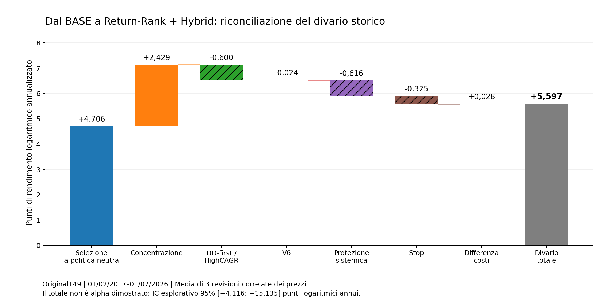

# ETF Trader: la selezione crea il vantaggio storico, le protezioni ne cambiano il rischio

**Riconciliazione dei componenti alla decisione finale — 31 ottobre 2026.**

## Risultato

La riconciliazione richiesta è stata eseguita sul sistema Original149, mantenendo prezzi, calendario e previsioni congelati. Il risultato non è una graduatoria di componenti da sommare: è una scomposizione verificabile delle scelte, dei pesi e dell'esecuzione, comprese le loro interazioni.

Nel confronto fra BASE completo e Return-Rank+Hybrid senza Ridge Tail, il divario osservato si chiude esattamente in **+5,5974 punti di rendimento logaritmico annualizzato**: **+4,7063** dovuti alla diversa selezione sotto una politica neutra identica e **+0,8911** alla diversa risposta dell'insieme dei controlli. Il CAGR medio delle tre revisioni dei prezzi passa da **31,7581% a 39,3304%**. Questo risultato storico NON è una superiorità futura dimostrata: l'intervallo temporale esplorativo al 95% del differenziale logaritmico è **[−4,1164; +15,1346] punti**, quindi comprende zero.

La controprova più precisa sulla selezione è un altro confronto, distinto: Hybrid da solo contro Return-Rank+Hybrid. Scambiando separatamente nomi e pesi, la selezione contribuisce **+12,2488 punti logaritmici annui**, mentre pesi e margine contribuiscono **−0,8200**. Non trasferire la significatività di questo confronto al confronto contro il BASE completo.

Le protezioni hanno soprattutto una funzione difensiva. Nel BASE, il MaxDD medio passa da **−54,79%** con la politica neutra a **−32,22%** con il sistema completo, mentre il CAGR medio passa da 30,81% a 31,76%. Un componente che riduce il rischio non va valutato soltanto dal suo incremento di CAGR.

## 1. Cosa è stato realmente eseguito

Sono state ricalcolate indipendentemente **51 curve archiviate** e prodotti **384 nuovi replay completi**: due politiche di score preidentificate, tre revisioni congelate dei prezzi e tutte le 64 combinazioni di sei componenti operativi. Nessun modello è stato addestrato e nessun parametro è stato scelto per massimizzare il risultato.

Il periodo canonico contiene **2.366 osservazioni dal 1 febbraio 2017 al 1 luglio 2026**, con 149 ETF. Le tre revisioni sono prezzi dello stesso mercato storico, NON tre mercati indipendenti. Tutti i risultati principali riportati come CAGR o MaxDD sono medie descrittive delle tre revisioni, salvo indicazione diversa.

Il motore originale, alimentato da OHLCV e score congelati, è stato prima riconciliato con gli archivi. Il motore strumentato, con tutti i controlli attivi, è stato poi confrontato con quello originale. Le sei ricostruzioni complete rispettano la tolleranza 1e-12 sulle curve; le selezioni e gli indici discreti coincidono. L'errore massimo delle identità additive giornaliere è circa **5,6e-17**. La coincidenza certifica la riproduzione del simulatore, non la correttezza finanziaria di ogni sua assunzione.

La nuova ricerca risiede soltanto in `research/component-reconciliation-20261031`, directory `audit/component_reconciliation_20261031`. Il riferimento di main rimane `77f7a4706f934e7061541cd62c1c0ce64ab7135d`. Il protocollo è stato salvato prima dei nuovi confronti di esecuzione.

Evidenze: [riepilogo verifiche](results/VERIFIED_SUMMARY.json), [parità](results/PARITY.json), [51 curve](results/ARCHIVED_51_PATHS_RECONCILIATION.csv), [384 replay](results/POLICY_FACTORIAL.csv), [protocollo](PROTOCOL.md).

## 2. La catena spiegata, non soltanto il risultato finale

La catena ricostruita è: **previsioni congelate → score combinato → primi due ETF → pesi/margine → esposizione DD-first/HighCAGR → eventuale alternativa V6 → controlli sui gap e stop → turnover/costi → capitale alla successiva valutazione**.

Il registro contiene **7.095 righe decisionali**, ossia 2.365 intervalli per tre revisioni. Per ogni data conserva ETF proposti, pesi, esposizione, ribilanciamenti effettivamente simulati, stop e differenza di PnL logaritmico. I file NPZ completi conservano anche flussi di commissioni, slippage, stato di cooldown e posizioni del motore.

La presenza di un ETF al primo posto non è equiparata automaticamente a un nuovo acquisto: il flag di ribilanciamento distingue la proposta dall'intervento. Una variazione di score può modificare anche la dimensione della posizione e il successivo stato delle protezioni. Questi effetti vengono ricalcolati, non congelati artificialmente.

**Convenzione temporale:** nel motore canonico E[k] rappresenta il capitale valutato alla successiva apertura rispetto alla data decisionale k. Il registro espone entrambe le date. L'ultima osservazione piatta originale è conservata. Le aggregazioni mensili e annuali seguono l'etichetta decisionale canonica, non una contabilità di regolamento di un intermediario.

Evidenze: [registro decisione-esecuzione](results/DECISION_TO_EXECUTION_LEDGER.csv), [campi del ledger](results/LEDGER_COLUMNS.json), [tutte le curve e i ledger](results/ALL_384_POLICY_PATHS.zip).

## 3. I modelli sono complementari: il contributo cambia con il contesto

In questo esperimento **B** è il Compact originale; **R** è `RETURN_RANK_NDCG`, non Compact127. **Titanium Tail** indica il pacchetto Ridge Tail; **Hybrid MA3** indica il pacchetto ET/XGB e il relativo canale di accordo fra modelli. Disattivare Hybrid nel vecchio esperimento cambia quel pacchetto, non una sola colonna di score.

| Titanium Ridge Tail | Hybrid MA3 | CAGR Compact originale B | CAGR Return-Rank R | Differenza R−B |
|---|---|---:|---:|---:|
| Spento | Spento | 23,4278% | 15,2515% | −8,1763 pp |
| Spento | Attivo | 30,4737% | 39,3304% | +8,8568 pp |
| Attivo | Spento | 20,0033% | 12,8877% | −7,1156 pp |
| Attivo | Attivo | 31,7581% | 35,8379% | +4,0798 pp |

Return-Rank perde senza Hybrid e guadagna quando Hybrid è attivo. Dire semplicemente «questo ranker è migliore» è quindi scorretto. Il risultato è un'interazione osservata fra componenti.

Anche «Tail» non è una cosa sola. Con Hybrid attivo, aggiungere il Ridge Tail migliora il Compact originale di circa **1,2844 pp di CAGR**, ma peggiora Return-Rank di circa **3,4925 pp**. Non è supportata l'eliminazione indiscriminata di tutti i moduli Tail, né una generalizzazione a ogni universo ETF.

Questo risultato non smentisce il precedente test sfavorevole a Compact127: `RETURN_RANK_NDCG` e la sostituzione Compact127 sono interventi diversi.

Evidenze: [otto configurazioni](results/SCORE_FACTORIAL_RECOMPUTED.csv), [interazioni esatte](results/SCORE_INTERACTIONS.csv), [attribuzioni condizionali](results/ATTRIBUTION_CONFIDENCE_INTERVALS.csv).

## 4. La prova che separa la scelta degli ETF dal loro peso

Il secondo archivio permette di scambiare separatamente i nomi scelti e il pacchetto peso/margine fra Hybrid solo (H) e Return-Rank+Hybrid (R), mantenendo il motore operativo originale.

| ETF scelti da | Pesi/margine da | CAGR medio |
|---|---|---:|
| Hybrid | Hybrid | 24,2910% |
| Hybrid | Return-Rank+Hybrid | 24,0741% |
| Return-Rank+Hybrid | Hybrid | 41,3909% |
| Return-Rank+Hybrid | Return-Rank+Hybrid | 39,3304% |

La scomposizione simmetrica delle quattro celle attribuisce:

| Contributo | Punti logaritmici annualizzati | IC esplorativo 95%, blocchi 21 sedute |
|---|---:|---:|
| Selezione ETF | **+12,2488** | **[+1,8697; +22,6528]** |
| Peso e margine | **−0,8200** | [−2,8251; +1,1786] |
| Totale riconciliato | **+11,4288** | Non sommare gli estremi degli intervalli |

Per la selezione l'intervallo resta positivo usando blocchi di 63 sedute: **[+2,1879; +22,3484]**. Resta positivo anche l'intervallo simultaneo sui due contributi della famiglia: **[+0,4274; +24,0701]** con blocchi di 21 sedute.

La conclusione consentita è circoscritta: **in questo confronto storico, il vantaggio viene dalla diversa scelta dei titoli, non dalla nuova regola di peso**. Non è una dimostrazione prospettica e non dimostra che 50/50 sia sempre ottimale. Peso e margine sono un pacchetto; le conseguenze sui controlli successivi sono incluse.

Evidenze: [curve mediate](results/ARCHIVED_51_PATHS_RECONCILIATION.csv), [contributi giornalieri](results/MEDIATION_DAILY_LOG.csv), [intervalli](results/ATTRIBUTION_CONFIDENCE_INTERVALS.csv).

## 5. I sei controlli operativi: attribuzione media e contributo marginale sono diversi

I sei interruttori sono: concentrazione basata su score/margine; esposizione DD-first/HighCAGR; alternativa V6; protezione sistemica basata sui gap; stop intraday condizionali al 5,5%; commissioni e slippage originali. Per ciascuno dei due score vengono eseguite tutte le 64 combinazioni sulle tre revisioni.

La politica neutra mantiene gli stessi ETF scelti, ma usa pesi 50/50, esposizione piena, nessuna alternativa V6, nessuna protezione e costi nulli. **Non è un benchmark investibile senza attriti**, né un controllo privo di capacità predittiva: serve a definire il controfattuale contabile.

| Score congelato | Politica | CAGR medio | MaxDD medio |
|---|---|---:|---:|
| BASE originale | Neutra | 30,81% | −54,79% |
| BASE originale | Completa | 31,76% | −32,22% |
| Return-Rank+Hybrid, senza Ridge | Neutra | 37,17% | −55,79% |
| Return-Rank+Hybrid, senza Ridge | Completa | 39,33% | −29,41% |

### Ripartizione dei contributi su tutte le combinazioni

Unità: **punti di rendimento logaritmico annualizzato**, non punti di CAGR.

| Controllo | BASE | Return-Rank+Hybrid |
|---|---:|---:|
| Concentrazione/peso dinamico | −1,7604 | +0,6683 |
| Esposizione DD-first/HighCAGR | −0,1863 | −0,7861 |
| Alternativa V6 | +0,0698 | +0,0457 |
| Protezione sistemica sui gap | +2,7784 | +2,1624 |
| Stop condizionali | +1,0782 | +0,7528 |
| Costi e slippage | −1,2606 | −1,2328 |
| **Totale** | **+0,7192** | **+1,6103** |

Queste sono attribuzioni Shapley: medie degli incrementi marginali su tutti gli ordini di inserimento. Le interazioni sono ripartite senza dipendere da un solo ordine arbitrario. La maggior parte degli intervalli sul rendimento comprende zero. Il piccolo contributo positivo di V6 non regge come alpha dimostrato quando si considera l'incertezza simultanea della famiglia. Il drag dei costi è invece chiaramente negativo nelle condizioni simulate.

La scomposizione separata del MaxDD del BASE attribuisce circa **+16,15 pp** di miglioramento alla protezione sistemica e **+11,04 pp** agli stop; la concentrazione sottrae circa **6,42 pp**. Questi numeri si combinano con gli altri effetti fino alla riduzione complessiva di 22,58 pp. Sono una ripartizione del drawdown storico, non probabilità di protezione futura né contributi sommabili nel tempo.

### Che cosa succede togliendo un controllo dal sistema già completo

La domanda operativa «lo tolgo adesso?» richiede il contributo marginale a tutti gli altri controlli attivi, non soltanto Shapley.

| Controllo presente, rispetto alla sua rimozione nel BASE | Δ CAGR | Miglioramento MaxDD |
|---|---:|---:|
| Concentrazione | −1,3670 pp | −6,4388 pp |
| DD-first/HighCAGR | −0,1288 pp | −0,1234 pp |
| V6 | +0,1802 pp | circa 0 |
| Protezione sistemica | **+2,0244 pp** | **+8,6232 pp** |
| Stop | **−0,5830 pp** | **+1,6528 pp** |
| Costi/slippage | −1,8555 pp | −0,4061 pp |

Gli stop illustrano l'interazione: positivi nell'attribuzione media fra configurazioni, ma nel sistema completo sacrificano un po' di rendimento per un ulteriore beneficio di drawdown. Non è una contraddizione e non è una giustificazione automatica per eliminarli.

V6 interviene soltanto in 11–13 sedute delle tre ricostruzioni BASE: in questo campione non può essere il motore principale della performance. DD-first/HighCAGR e la protezione sistemica sono componenti distinti; non attribuire al primo il beneficio misurato del secondo.

Evidenze: [fattoriale completo](results/POLICY_FACTORIAL.csv), [contributo marginale nel sistema completo](results/POLICY_LEAVE_ONE_OUT.csv), [ripartizione MaxDD](results/DRAWDOWN_SHAPLEY.csv).

## 6. Il ponte esatto dal BASE al candidato

Per riconciliare i due sistemi completi senza sommare test incompatibili, uso una gerarchia esplicita: prima confronto le selezioni sotto la stessa politica neutra; poi confronto, controllo per controllo, il modo in cui ciascuna selezione beneficia o soffre dell'esecuzione.

| Passaggio | Contributo al divario, punti logaritmici annui |
|---|---:|
| Selezione diversa sotto identica politica neutra | **+4,70631** |
| Diverso effetto della concentrazione | +2,42868 |
| Diverso effetto di DD-first/HighCAGR | −0,59989 |
| Diverso effetto di V6 | −0,02406 |
| Diverso effetto della protezione sistemica | −0,61599 |
| Diverso effetto degli stop | −0,32543 |
| Differenza di costi/slippage | +0,02778 |
| **Totale** | **+5,59741** |

La selezione spiega +4,70631 e la diversa risposta ai controlli spiega il resto, +0,89110. Il differenziale sui costi è trascurabile rispetto alla selezione. Non è supportata la spiegazione «il candidato vince solo perché ruota meno».

Il BASE completo ha log-rendimento annualizzato medio 27,56697%; il candidato 33,16438%. La conversione `exp(media log)−1` produce CAGR equivalenti 31,7413% e 39,3256%. Sono leggermente diversi dalla media aritmetica dei CAGR delle tre revisioni, 31,7581% e 39,3304%. Le due convenzioni non vengono mescolate: l'identità additiva è esatta nello spazio logaritmico.

**Il risultato favorevole non è uniforme:** il candidato perde contro il BASE nel 2017, 2019 e 2023, è quasi pari nel 2022 e guadagna negli altri sottoperiodi documentati. Il 2026 è parziale. Non viene introdotto alcuno switch retrospettivo basato sull'anno migliore.

Evidenze: [ponte numerico](results/EXACT_FINAL_BRIDGE.csv), [identità contabili](results/ACCOUNTING_RECONCILIATION.csv), [attribuzione mensile](results/FINAL_CONTRAST_MONTHLY.csv), [attribuzione annuale](results/FINAL_CONTRAST_YEARLY.csv).

## 7. Metodo, incertezza e ciò che non è dimostrato

Per ogni configurazione S e data t si calcola `l_t(S)=log(NAV_t(S)/NAV_previous(S))`, con capitale iniziale 1. Per ogni componente j, Shapley media `l_t(S+j)−l_t(S)` su tutte le coalizioni degli altri componenti con pesi fattoriali. La somma dei contributi coincide per ogni giorno con `l_t(tutti)−l_t(nessuno)`. Le somme temporali, moltiplicate per `252/2366`, producono il ponte annualizzato.

La scelta dello stato spento, dei componenti raggruppati e dell'output spiegato è sostanziale: Shapley non assegna un valore intrinseco universale a un modulo. Per questo il rapporto esplicita pacchetti e controfattuali. Riferimento metodologico: Covert, Lundberg e Lee, [Explaining by Removing, JMLR 2021](https://jmlr.org/papers/v22/20-1316.html).

I confronti temporali usano bootstrap circolare appaiato con **10.000 estrazioni, seed 20261031**, blocchi di 21 sedute e controllo a 63 sedute. Le tre revisioni dei prezzi vengono mediate per data PRIMA del bootstrap. Gli intervalli simultanei max-T coprono soltanto la famiglia dichiarata, non correggono retroattivamente tutte le ricerche precedenti nel repository. Sono controlli esplorativi su storia già usata, non un holdout intatto.

Il confronto finale candidato−BASE vale +5,5974 punti logaritmici annui; IC 21 sedute **[−4,1164; +15,1346]**, IC 63 sedute **[−3,5662; +14,8260]**. L'incertezza non annulla la riconciliazione storica, ma impedisce di chiamare dimostrata la superiorità futura.

I replay conservano le convenzioni originali di prezzi adjusted, calendario, riempimenti dei dati e simulazione dei fill. Non certificano prezzi realmente eseguibili, corporate actions, delisting, survivorship o causalità di ogni feature di training. I modelli non sono stati rifittati. Il parametro commissionale .001 è applicato al turnover definito dal motore, che non va confuso automaticamente con una tariffa unidirezionale per ordine. Lo slippage degli stop è .001 quando il controllo costi è attivo.

La disattivazione dei gap sistemici toglie quel trigger, non il cooldown causato da eventuali stop ancora attivi. La disattivazione di DD gross può rendere V6 inattivo perché manca il budget residuo di cash: è un'interazione del contratto, non un bug. I conti includono il feedback dello stato e dell'esposizione lungo l'intera traiettoria.

## 8. Decisione supportata dalla riconciliazione

**Conservare la complementarità nella selezione.** Le evidenze non sostengono la ricerca di un singolo ranker vincitore in ogni contesto. Il segnale Return-Rank va interpretato insieme a Hybrid, non estratto e giudicato dal suo test isolato.

**Non equiparare il margine di score a una probabilità affidabile di successo.** In queste prove il pacchetto di concentrazione non produce un miglioramento robusto e cambia segno fra score. Questo indica un problema di calibrazione da distinguere dalla qualità della selezione; non autorizza a scegliere retrospettivamente i pesi del miglior CAGR.

**Attribuire alle protezioni il loro compito reale.** La difesa dai gap e gli stop spiegano gran parte della riduzione del drawdown. La ridondanza fra controlli spiega perché un beneficio medio positivo possa diventare un costo di rendimento nell'ultimo passaggio. Il giudizio deve includere perdite evitate e opportunità perse, non soltanto il CAGR.

**Non promuovere automaticamente il candidato al 39,33%.** Il BASE completo resta il confronto operativo. La selezione è favorevole rispetto a Hybrid solo, ma la superiorità contro il BASE non è statisticamente stabilita. Nessuna pipeline produttiva o strategia è stata modificata.

Il risultato consegnato è quindi una riconciliazione chiusa e riproducibile dei contratti esaminati, non la certificazione integrale di tutti i componenti di training o di tutti i branch del repository.

## Fonti congelate e riproduzione

- Prezzi Original149: run `37121749852`, artifact `11272972639`.
- Score fattoriali: run `39058118631`, artifact `12110461075`.
- Scambio selezione/peso: run `39060389253`, artifact `12111590600`.
- Sorgente canonica: commit `13443836649d0f107d2063eb7acc1039135d6e9b`.
- Workflow di riproduzione: `.github/workflows/component-reconciliation-20261031.yml`, run `41160544978`.
- I tre ZIP di input sono conservati in `inputs/`, con SHA-256; non dipendono soltanto dalla scadenza degli artifact di Actions. `CANONICAL_SOURCE.tar.gz` conserva il codice canonico necessario.
- `RUN_MANIFEST.json` registra digest del codice e dei dati; `PARITY.json` espone gli scarti; `DELIVERY_MANIFEST.json` permette il controllo dei file persistenti.

Per riprodurre: impostare `RECONCILIATION_ROOT`, ripristinare gli input e il sorgente nelle sottocartelle definite da `engine_prepare.py`, copiare gli script in `work/`, eseguire `build_instrumented.py`, i test, `run_policy_factorial.py` e `analyze_reconciliation.py`. Il workflow versionato contiene il procedimento eseguibile completo e le versioni delle dipendenze. Il pacchetto consegnato contiene le tabelle, il codice e tutte le 384 curve; i grandi input congelati sono nel branch del repository.
