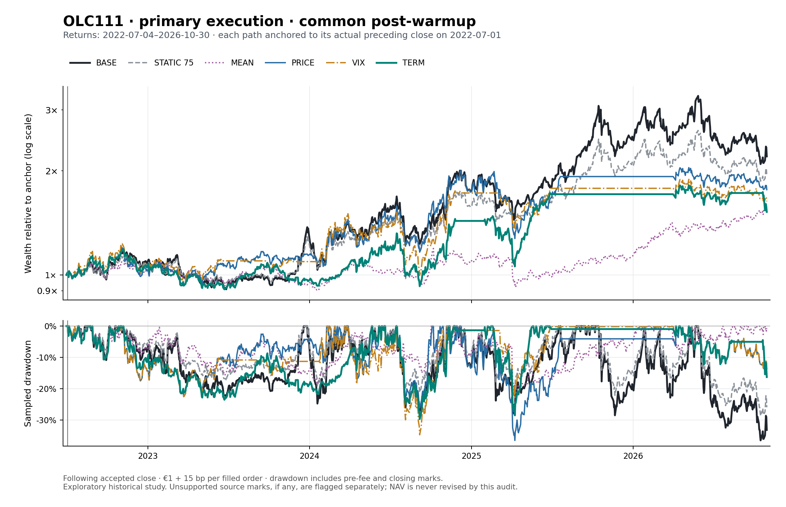

# OLC111 — Esito della ricerca su cash, rientro e volatilità implicita

**16 novembre 2026. Esito: ipotesi respinta; nessuna strategia promossa.**

L'informazione aggiunta sulle diverse scadenze della volatilità implicita non ha prodotto il salto richiesto. Nel confronto principale, a prezzi di esecuzione e costi identici, il modello completo scende al **15,95% di CAGR**, contro **22,57%** del selettore base. Nel periodo in cui il modello può effettivamente intervenire, il confronto è **10,17% contro 20,01%**. Anche gli errori previsivi peggiorano rispetto alla versione che dispone già del solo blocco VIX. Il target di circa 30% non è raggiunto da nessuna delle 18 simulazioni.

Questa conclusione riguarda il test descritto, non dimostra che ogni possibile uso delle opzioni sia inutile. Non vengono cambiati soglie, orizzonti o penalizzazioni per ottenere retrospettivamente un risultato migliore.

## 1. Che cosa è stato provato

L'universo è il pannello congelato di **2.096 ISIN quotati in EUR**, con disponibilità storica e filtro di liquidità a ogni data. Non sono 29 ETF. Non è però un censimento completo e privo di survivorship bias di tutti gli ETF esistiti: il catalogo è attuale e questa limitazione resta.

Il selettore `DEDUP_DUAL_TREND_OPP` rimane identico a OLC109. Il nuovo modello sceglie quotidianamente fra conservare le quantità effettive, vendere in cash o comprare il paniere proposto oggi dal selettore. Tre regressioni separate stimano il vantaggio economico netto di uscita, sostituzione ed entrata. I confronti partono dalle medesime quantità e cassa; applicano ordini, gap, ritardi e costi nativi e una continuazione mensile comune per 21 sedute. Non sono semplici rendimenti degli ETF senza contabilizzazione.

Le informazioni sono aggiunte in sequenza: media storica, soli prezzi/stato del conto, VIX e sua variazione, infine rapporti VIX9D/VIX e VIX/VIX3M. Cboe descrive questi tre indici come aspettative di volatilità S&P500 a 9 giorni, 30 giorni e 3 mesi; qui sono fattori informativi, non strumenti negoziati. [Fonte ufficiale Cboe](https://www.cboe.com/tradable_products/vix/term_structure).

Le osservazioni USA devono precedere strettamente la data europea del segnale, avere data comune e anzianità massima di sette giorni. Non si usa la chiusura finale USA dello stesso giorno per decidere alla chiusura europea. VVIX e SKEW sono stati acquisiti ma non utilizzati.

## 2. Risultati comparabili

Conto iniziale 10.000 EUR, unità economiche frazionarie, nessun prestito/short, cash a rendimento zero, imposte escluse. Esecuzione principale al Close successivo accettato; costo 1 EUR +15 punti base per ordine effettivamente eseguito. Il MaxDD è campionato sui valori del conto prima/dopo i costi del Close, non su un percorso intraday certificato.

| Variante | CAGR intero periodo | MaxDD intero periodo | CAGR dal 04/07/2022 | MaxDD dal 04/07/2022 | Giorni interamente cash |
|---|---:|---:|---:|---:|---:|
| Selettore base | 22,57% | -36,51% | 20,01% | -36,51% | 0 |
| Base investita al 75% | 18,38% | -30,08% | 16,53% | -28,64% | 0 |
| Media storica | 16,23% | -36,10% | 10,58% | -22,34% | 0 |
| Modello prezzi | 18,56% | -36,53% | 14,02% | -36,53% | 178 |
| Prezzi + VIX | 17,18% | -36,10% | 11,97% | -34,72% | 373 |
| Prezzi + VIX + struttura | 15,95% | -36,10% | 10,17% | -29,70% | 282 |

Periodo completo: **02/03/2020–30/10/2026**. Periodo comune successivo alla preparazione: **04/07/2022–30/10/2026**, usando per ciascun conto il proprio NAV alla chiusura del 01/07/2022 come denominatore. I modelli di uscita/entrata sono pronti dall'aprile 2022, quello di sostituzione dal luglio 2022; per evitare una trappola cash, nessun modello opera prima che siano pronti tutti e tre.

I guadagni del 2020 e il risultato del 2021 appartengono quindi integralmente alla base. Non sono risultati del nuovo modello. Per TERM il drawdown massimo dell'intero periodo è inoltre dominato dalla fase precedente all'attivazione.

Nel periodo attivo, `STATIC_75` supera tutte le tre versioni che usano fattori di prezzo/opzioni sia per CAGR sia per MaxDD. Questo rende insufficiente presentare il minor drawdown di TERM come un miglioramento della protezione: una riduzione costante dell'esposizione ha un compromesso migliore nel campione.

[Dati aggregati](results/SCORES.csv) · [Periodo comune](results/COMMON_POST_WARMUP.csv) · [Rendimenti annuali](results/ANNUAL_RETURNS.csv).

## 3. Il nuovo dato predice meglio?

No, secondo il confronto predefinito. Il modello con la struttura per scadenza ha un MSE maggiore rispetto al modello con VIX per tutte e tre le decisioni:

| Decisione | MSE TERM rispetto a VIX | Media netta dei confronti qualificati TERM | Episodi separati nella banca |
|---|---:|---:|---:|
| Uscire in cash | +1.87% | -21.29 bp | 9 |
| Sostituire il paniere | +0.90% | 64.81 bp | 6 |
| Entrare dalla cassa | +1.70% | -65.60 bp | 19 |

Un aumento del MSE indica un errore quadratico medio peggiore. I punti base nella terza colonna sono vantaggi netti a21 sedute rispetto all'azione di riferimento, condizionati al superamento del filtro di quel singolo head nella banca di stati. **Non sono alpha realizzato dal conto, non sono necessariamente l'azione vincente fra CASH e FRESH e non vanno sommati o annualizzati.** I confronti possono sovrapporsi.

La versione PRICE migliora il MSE di uscita/entrata rispetto alla media solo modestamente, mentre peggiora quello di sostituzione. Nel conto effettivo produce appena **un'uscita cash e un rientro** sul periodo completo. TERM ne produce tre ciascuno. Questi campioni sono troppo piccoli per una conclusione affidabile sui tempi corretti di ingresso; il criterio diagnostico previsto è almeno 12 episodi separati per famiglia.

[Previsioni cronologiche](results/PREQUENTIAL_FORECASTS.csv.gz) · [Diagnostica delle previsioni](results/FORECAST_SCORES.csv).

## 4. Un effetto del disegno da isolare

In OLC111, dopo l'attivazione, HOLD può saltare anche il ribilanciamento mensile. La versione MEAN non autorizza interventi e conserva pertanto il vecchio paniere. La nuova regola finisce così per modificare anche la rotazione che generava parte del rendimento della base. È una conseguenza del protocollo, non un errore contabile nascosto.

È stato quindi predefinito **OLC112**, separatamente e dopo aver visto questi risultati: preservare la rotazione mensile quando il conto è investito e usare gli stessi identici modelli per azioni intermedie e rientri dalla cassa. Non rifare il fitting e non modificare le soglie consente di attribuire il confronto a una sola scelta operativa. OLC112 resta un'analisi adattiva successiva, non un campione indipendente. L'ipotesi informativa TERM respinta qui non viene riabilitata da eventuali differenze del percorso di portafoglio successivo.

## 5. Sensibilità a prezzi e costi

| Variante | Close normale | Close costi doppi | Open normale |
|---|---:|---:|---:|
| Selettore base | 22,57% | 19,71% | 25,75% |
| Base investita al 75% | 18,38% | 16,01% | 20,50% |
| Media storica | 16,23% | 15,24% | 17,21% |
| Modello prezzi | 18,56% | 17,33% | 20,37% |
| Prezzi + VIX | 17,18% | 15,49% | 17,96% |
| Prezzi + VIX + struttura | 15,95% | 14,61% | 18,63% |

La terza colonna di scenario usa il vecchio next Open per confrontabilità; la maschera di eseguibilità Open dipende anche dal volume dell'intera giornata. Per questo il next Close è primario. Nessuno dei due costituisce prova della disponibilità di un'asta reale alla quantità simulata. I modelli sono sempre quelli stimati sui confronti next Close a costi normali; non vengono riaddestrati per rendere migliori gli stress.

## 6. Evidenza, riproducibilità e limiti

La banca contiene 1.642 etichette CASH,1.512 FRESH e1.642 ENTRY. Sono 4.796 vantaggi condizionali ricavati da 3.284 gruppi di confronti nativi; non sono 4.796 episodi di mercato indipendenti. Sono registrate 33 date senza supporto comune dei dati Cboe e 20 date al limite destro. Nei gruppi effettivamente valutati non si sono verificate censure per quotazioni detenute troppo vecchie.

Per 1.566 confronti HOLD non mensili, il NAV finale del replay coincide con quello del percorso completo della base entro 2,2×10^-11 EUR. Ogni etichetta netta è stata ricostruita dai NAV salvati. Il codice, il protocollo, i dati e le cache sono identificati prima di fitting e simulazioni; i risultati includono tutti gli ordini, le istruzioni, i conti giornalieri, le decisioni e i modelli mensili.

Il fitting cronologico usa solo esiti già conclusi prima del cutoff e una rappresentazione calcolata sui soli dati di training. Il filtro basato sul bootstrap a blocchi è una scelta prudenziale, non una probabilità calibrata del 90%. Il periodo è stato usato in molte ricerche precedenti: non è un holdout intatto. Catalogo attuale, revisioni dei prezzi rettificati, esecuzione giornaliera semplificata e distribuzione degli stati diversa da quella del conto appreso rimangono limiti concreti.

[Protocollo](docs/DESIGN_AND_PROTOCOL.md) · [Freeze](docs/EXPERIMENT_FREEZE.json) · [Revisione indipendente del codice](research/final_review/FINAL_CODE_REVIEW.md) · [Ripristino degli input](docs/RESTORE_INPUTS.md).

**Decisione: mantenere OLC111 come esperimento negativo documentato. Nessuna promozione operativa e nessuna affermazione di 30% dimostrato.**

## Appendice: controllo indipendente dei risultati

La ricostruzione indipendente conferma tutti i 18 conti, i denominatori del periodo comune e i risultati aggregati. Non emergono valutazioni di posizioni detenute con prezzi più vecchi di cinque giorni di calendario. Il massimo scarto nella ricostruzione del NAV è circa 1,2×10^-10 EUR. Le tre istruzioni ENTRY effettivamente eseguite di TERM corrispondono a due episodi separati con orizzonte di 21 sedute completato; il rientro di ottobre 2026 è ancora incompleto a fine campione.

[Diagnostica indipendente](results/INDEPENDENT_DIAGNOSTICS.json) · [Note analitiche](research/design/RESULT_ANALYSIS_NOTES.md).

