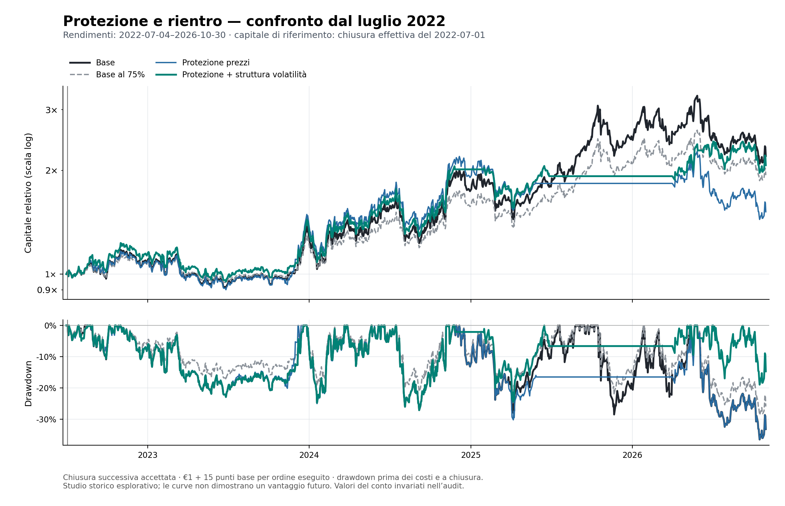

# OLC112 — Protezione e rientro preservando la rotazione mensile

**16 novembre 2026. Il target di circa 30% CAGR non è raggiunto. La variante primaria fallisce; una variante secondaria mostra un compromesso storico fra rendimento e drawdown da conservare per la ricerca. Nessuna promozione operativa.**

Ho completato il confronto che mancava: mantenere il selettore mensile quando il conto è investito e usare gli stessi modelli OLC111 per le uscite in cash, gli ingressi dalla cassa e le opportunità fra un ribilanciamento e l'altro. Non è stato riaddestrato alcun modello; i parametri e i dati sono identici.

Il risultato più interessante è secondario: dal luglio 2022, la variante con struttura della volatilità riduce il MaxDD dal **−36,51% al −27,11%**, cedendo CAGR dal **20,01% al 18,32%**. Sono circa **9,41 punti percentuali di drawdown in meno** e **1,69 punti di CAGR in meno**. È un compromesso storico migliore della base al 75% nello scenario principale, ma non il miglioramento simultaneo di CAGR e MaxDD richiesto e non una dimostrazione di capacità predittiva.

## 1. Il risultato primario e tutte le alternative

La variante dichiarata primaria prima di OLC112 era `PRICE_ROTATION`, basata su prezzi e stato del conto. Il suo risultato è negativo: **15,90% di CAGR sull'intero periodo**, contro **22,57%** della base; nel periodo attivo scende al **10,10%**, contro **20,01%**. Questo risultato non viene sostituito retrospettivamente dal migliore ramo secondario.

| Variante | CAGR completo | MaxDD completo | CAGR dal 04/07/2022 | MaxDD dal 04/07/2022 | Sedute interamente cash |
|---|---:|---:|---:|---:|---:|
| Selettore base | 22,57% | -36,51% | 20,01% | -36,51% | 0 |
| Base al 75% | 18,38% | -30,08% | 16,53% | -28,64% | 0 |
| Protezione prezzi (primaria) | 15,90% | -36,52% | 10,10% | -36,52% | 215 |
| Protezione prezzi + VIX | 12,85% | -36,53% | 5,67% | -36,53% | 344 |
| Protezione + struttura volatilità | 21,44% | -36,10% | 18,32% | -27,11% | 243 |

Scenario principale: esecuzione al successivo Close accettato, costo di **1 EUR +15 bp per ordine realmente eseguito**, conto iniziale di 10.000 EUR. Il periodo completo è **02/03/2020–30/10/2026**. Il periodo attivo è **04/07/2022–30/10/2026**, con il NAV effettivo della chiusura del 01/07/2022 come denominatore di ogni conto. Cash senza rendimento, unità economiche frazionarie, imposte escluse, nessun prestito o short sul conto.

Il drawdown completo incorpora la fase precedente all'attivazione del modello; per valutare la nuova protezione è essenziale leggere anche la colonna del periodo attivo. Nessuna delle 12 nuove simulazioni raggiunge il 30% di CAGR. I sei percorsi di controllo sono gli stessi già calcolati in OLC111.

[Dati completi](results/SCORES.csv) · [Periodo comune](results/COMMON_POST_WARMUP.csv) · [Rendimenti annuali](results/ANNUAL_RETURNS.csv).

## 2. Che cosa cambia rispetto a OLC111

OLC111 lasciava al modello la possibilità di saltare anche la rotazione mensile. Con valori stimati insufficientemente positivi, HOLD poteva congelare il vecchio paniere per molto tempo. OLC112 cambia soltanto questo comportamento:

- Se il conto è investito, alla data mensile e in assenza di ordini pendenti viene applicato il target del selettore originale, mantenendo la sua banda di ribilanciamento del 3%.
- Tra le date mensili restano le medesime decisioni CASH/FRESH/HOLD di OLC111.
- Quando il conto è cash, anche alla data mensile deve arrivare il segnale ENTRY: non è imposto un acquisto automatico.
- Il modello non apre una nuova uscita cash proprio sulla data mensile in cui viene preservata la rotazione. Può rivalutarla alla chiusura non mensile successiva.

Questa è una diagnosi di un meccanismo, predefinita **dopo aver visto OLC111**. Gli 81 file di modelli mensili vengono riutilizzati, senza nuovi fit, soglie, orizzonti o griglie di ricerca. La cronologia evita alcune anticipazioni dei dati, ma il confronto resta adattivo e su un campione già molto studiato.

Il controllo `MEAN_ROTATION`, che non autorizza azioni discrezionali, **riproduce esattamente BASE in tutti e tre gli scenari**: NAV, cassa, esposizione e numero di posizioni coincidono. Questo conferma che il meccanismo di rotazione è stato effettivamente conservato. [Riscontro dei conti](results/MEAN_BASE_REPLICATION.json).

## 3. Il problema misurato: permanenza troppo lunga in cash

La variante secondaria TERM compie **tre uscite e tre rientri effettivi** nello scenario principale. I periodi interamente cash sono:

| Prima chiusura cash | Ultima chiusura cash | Sedute | Rendimento della base nello stesso intervallo |
|---|---|---:|---:|
| 26/11/2024 | 29/01/2025 | 42 | −7,41% |
| 27/06/2025 | 01/04/2026 | 194 | +42,48% |
| 29/05/2026 | 08/06/2026 | 7 | −15,11% |

Il rendimento della base è calcolato dal suo NAV alla chiusura precedente la prima data cash fino all'ultima data cash. È un confronto descrittivo con il percorso BASE: **non è il profitto controfattuale certo della variante, non misura un alpha causale e non va sommato alle performance del conto**.

Il dato operativo è comunque netto: il modello può evitare una discesa, ma può poi restare fuori per molti mesi. Nel periodo centrale sopra, la base cresce di oltre il 42% mentre la variante resta cash. La versione primaria PRICE ha un unico periodo cash di **215 sedute**, dal 29/05/2025 al 01/04/2026; la base, nel medesimo intervallo definito nello stesso modo, cresce di circa **48,80%**.

Il conto TERM chiude il 2025 a **−4,46%**, contro **+44,38%** della base; nel 2026 fino al 30 ottobre ottiene invece **+7,60%**, contro **−12,36%** della base. La protezione trova alcuni episodi favorevoli, ma il costo di restare fuori dalla crescita è elevato. Questo spiega perché ridurre il drawdown non si trasforma automaticamente in CAGR maggiore.

C'è anche un limite specifico del modello: i target di training misurano un intervento di 21 sedute con successiva continuazione mensile comune, mentre la politica ripetuta può produrre escursioni cash di 194 o 215 sedute. Il giudizio economico su un'uscita deve comprendere il successivo rientro e l'opportunità persa durante l'intero ciclo; il presente stimatore a un passo non ha dimostrato di gestirlo bene.

## 4. Il compromesso rischio/rendimento resiste agli stress?

Per la variante secondaria TERM, il drawdown del periodo attivo resta inferiore a BASE in tutti e tre gli scenari dichiarati, mentre il CAGR resta inferiore:

| Esecuzione e costi | CAGR base nel periodo attivo | CAGR TERM nel periodo attivo | MaxDD base | MaxDD TERM |
|---|---:|---:|---:|---:|
| Close successivo, costi normali | 20,01% | 18,32% | -36,51% | -27,11% |
| Close successivo, costi doppi | 17,26% | 15,75% | -37,10% | -27,36% |
| Open successivo, costi normali | 23,23% | 20,17% | -36,00% | -28,76% |

I costi doppi sono 2 EUR +30 bp per ordine. Lo scenario Open mantiene la convenzione precedente per confrontabilità, ma la disponibilità della quotazione Open dipende anche dal volume giornaliero completato; non certifica l'eseguibilità in asta. I modelli non vengono ristimati per uno scenario diverso.

Nel confronto principale del periodo attivo, TERM supera `STATIC_75` sia per CAGR (18,32% contro 16,53%) sia per MaxDD (−27,11% contro −28,64%). Con esecuzione Open, il vantaggio di CAGR su STATIC_75 rimane, ma il MaxDD è leggermente peggiore. Non presento quindi quel confronto come una dominanza universale.

## 5. Perché non promuovo la variante secondaria

Il miglior compromesso TERM è stato riconosciuto fra i risultati dopo l'esperimento. La variante primaria PRICE aveva fallito e l'informazione aggiunta TERM in OLC111 aveva peggiorato il MSE di tutte e tre le previsioni rispetto a VIX. Il migliore percorso di portafoglio successivo non cancella quel fallimento informativo.

Le azioni cash/entry sono inoltre troppo poche. Tre cicli effettivi non soddisfano il criterio diagnostico di almeno 12 episodi separati e completati per una famiglia di azioni. Mantenere la variante come riferimento per la ricerca sul rischio è diverso dal concludere che sappia prevedere il prossimo ingresso corretto.

L'universo resta quello di 2.096 ISIN EUR con filtri storici di eleggibilità e liquidità. Catalogo attuale, possibili revisioni dei prezzi rettificati, esecuzione su barre giornaliere e assenza di un holdout intatto limitano tutte le conclusioni. Le performance sono simulazioni storiche, non rendimenti realizzati su un conto dell'utente.

## 6. Stato del lavoro e decisione

Sono preservati sia i 18 percorsi OLC111 sia i 12 OLC112, con codice, protocolli precedenti ai rispettivi risultati, modelli, ordini, conti giornalieri e tracce delle decisioni. OLC112 è esplicitamente successivo all'osservazione di OLC111. Il codice e le dipendenze finanziarie precedenti restano immutati.

La revisione mirata conferma il riuso dei modelli senza rifit, la riproduzione esatta del controllo e i valori finanziari dei conti salvati. Resta una miglioria tecnica non bloccante: un'interruzione fra il salvataggio delle metriche MEAN e quello del relativo riscontro di parità può richiedere la rigenerazione del checkpoint incompleto; tutti i file necessari esistono in questo run e i risultati non ne dipendono.

**Decisione: non sostituire la base con il candidato primario PRICE. Conservare TERM_ROTATION come compromesso di rischio esplorativo, insieme alla base e a STATIC_75. Non dichiarare raggiunto il 30%, un aumento simultaneo di rendimento e protezione, o una capacità affidabile di rientro.**

[Protocollo adattivo](docs/DESIGN_AND_PROTOCOL.md) · [Freeze](docs/EXPERIMENT_FREEZE.json) · [Revisione indipendente](docs/INDEPENDENT_CODE_REVIEW.md) · [Studio OLC111](../olc111/RAPPORTO_OLC111_IT.md).

## Appendice: verifica indipendente e figura

La verifica indipendente ricostruisce i 12 conti nuovi e i sei controlli dai singoli ordini, compresi costi, quantità, cassa e prezzi accettati. Sono confermati i rendimenti completi e del periodo comune, la perfetta coincidenza della fase iniziale e il rispetto del limite di cinque giorni per i prezzi delle posizioni detenute. Tutti gli input e gli 81 file di modelli conservano gli hash congelati.

[Diagnostica indipendente](results/INDEPENDENT_DIAGNOSTICS.json) · [Intervalli cash e confronto descrittivo con BASE](results/INDEPENDENT_CASH_CONTEXT.csv) · [Note dell’analisi](research/design/RESULT_ANALYSIS_NOTES.md).

