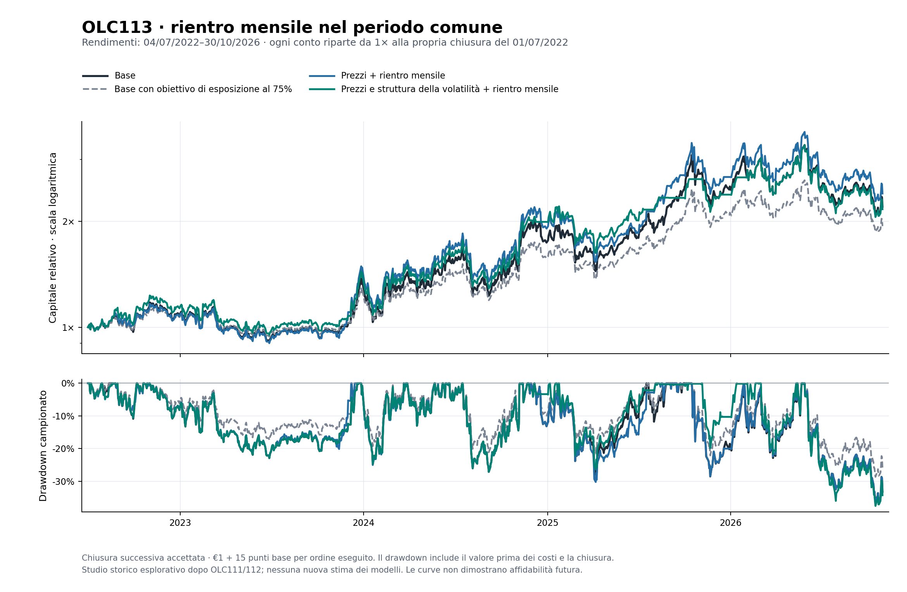
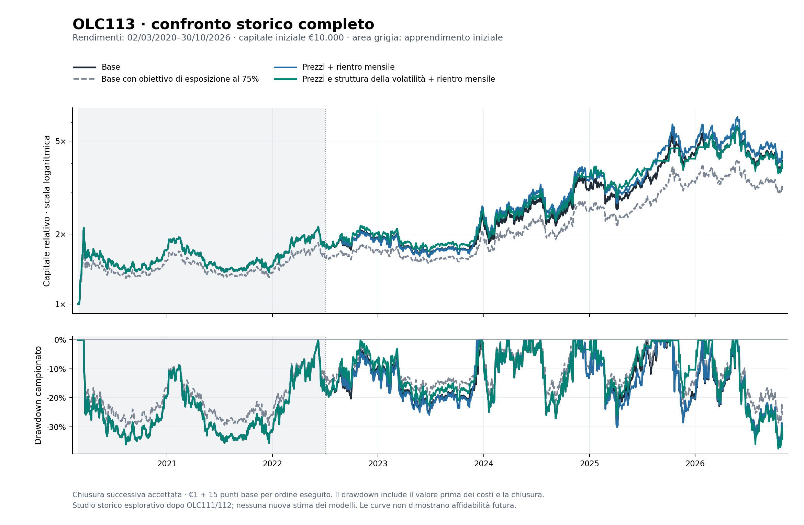

# OLC113 — Protezione e rientro: rapporto conclusivo

**16 novembre 2026. Esito economico: il salto netto richiesto non è stato ottenuto.**

PRICE_RESET, la variante primaria dichiarata prima del test, ottiene il **24,1622% di CAGR** contro il **22,5708% della base** sul periodo 2 marzo 2020–30 ottobre 2026. Il guadagno è **+1,5914 punti percentuali annui**. Il MaxDD campionato passa da −36,5142% a −36,5126%: una variazione di appena **0,0016609 punti percentuali**, economicamente trascurabile. Nel periodo comune dal 4 luglio 2022 il CAGR è 22,4209% contro 20,0121%, con lo stesso drawdown. Nessuna variante soddisfa il criterio prefissato di almeno +3 punti di CAGR e drawdown non peggiore in entrambe le finestre; nessuna raggiunge il 30% di CAGR.

Il risultato identifica una correzione concreta della precedente gestione del cash. Non dimostra una nuova informazione predittiva e non risolve il problema della protezione nelle perdite peggiori. Il presente studio viene conservato come ricerca, insieme ai risultati negativi.

## Che cosa è stato corretto

Le etichette usate in OLC111 confrontavano un intervento immediato con una prosecuzione che tornava comunque al selettore mensile. In OLC112, invece, un conto già interamente cash poteva ignorare indefinitamente quelle scadenze. La previsione ENTRY confrontava quindi l'ingresso immediato con un'attesa limitata dal prossimo ritorno alla strategia di base; la policy effettiva poteva trasformare quell'attesa in mesi fuori mercato.

La diagnosi ha ricostruito 215 giorni decisionali validi nello spell principale PRICE e 194 in quello TERM: i candidati e i modelli erano disponibili. PRICE saltava 11 scadenze mensili e TERM 10. Queste durate descrivono gli spell analizzati nella diagnosi; non sono necessariamente tutti i giorni cash del relativo conto. I dettagli, incluse le previsioni e le identità dei modelli, sono nel [rapporto di diagnosi](research/reentry_diagnosis/REENTRY_DIAGNOSIS.md).

OLC113 modifica soltanto il comportamento alle chiusure mensili: quando il conto è libero da istruzioni pendenti e tutti i modelli sono pronti, ripristina il target della base anche dal cash, con la normale banda di ribilanciamento del 3%. Un acquisto resta eseguibile soltanto su una barra successiva accettata. Gli interventi nei giorni non mensili, gli input, i candidati, i parametri, le previsioni e gli 81 file di fitting rimangono identici. Non sono stati addestrati nuovi modelli.

La correzione riduce i giorni completamente cash di PRICE da **215 a 29** e ne aumenta il CAGR completo dal **15,9016% al 24,1622%**. È un recupero di **8,2606 punti** rispetto alla versione OLC112; il confronto economico decisivo con la base resta però +1,5914 punti, con drawdown quasi immutato. Tutti i rientri primari dal cash avvengono tramite il reset mensile: **zero ordini ENTRY appresi** nei quattro conti NEXT_CLOSE.

## Universo, capitale e convenzioni

Il pannello congelato contiene **2.096 ISIN EUR del catalogo corrente Xetra**, con storia del pannello dal 1° febbraio 2019. Il conto viene simulato dal 2 marzo 2020 al 30 ottobre 2026, con 10.000 EUR iniziali, quantità frazionarie, nessun prestito o posizione corta del conto, cash senza rendimento e imposte escluse. Questo universo è più ampio degli originari 29 strumenti, ma non rappresenta tutti gli ETF mai esistiti: il catalogo attuale e la disponibilità storica dei prezzi lasciano un rischio di sopravvivenza e di revisione delle serie.

La convenzione principale esegue al successivo Close accettato, con 1 EUR più 15 punti base per ordine effettivamente eseguito. Lo stress raddoppia entrambe le componenti. NEXT_OPEN è soltanto una sensibilità: la maschera di disponibilità usa anche il volume giornaliero completato e non certifica l'eseguibilità in asta di apertura. I risultati sono netti dei costi modellati, prima delle imposte.

La finestra comune comincia il 4 luglio 2022, dopo la prima disponibilità contemporanea dei tre modelli al 1° luglio. Ogni conto usa come denominatore il proprio NAV effettivo alla chiusura precedente; nella convenzione primaria BASE e PRICE partono da 17.631,8353846 EUR. I rendimenti precedenti appartengono alla fase di avvio della base e non vengono attribuiti alla policy appresa. Il CAGR conserva la convenzione nativa di giorni di calendario inclusivi: 2.434 per il periodo completo e 1.580 per quello comune. Il MaxDD campiona i valori previsti dal motore prima e dopo l'esecuzione e a chiusura; non è una ricostruzione di tutti i minimi intraday.

## Perché il risultato non basta

Il peggiore drawdown di PRICE e BASE coincide: picco del **28 maggio 2026**, minimo del **16 ottobre 2026**, senza recupero entro il 30 ottobre. La correzione dell'attesa non protegge quindi dalla principale perdita osservata.

Il contributo positivo del 2023 alla crescita logaritmica relativa di PRICE rispetto a BASE è +0,088277, superiore al guadagno relativo netto dell'intero periodo comune, +0,085965. Le altre annate comprendono contributi negativi. La prestazione favorevole non è distribuita uniformemente tra gli anni. Con costi doppi il vantaggio rimane positivo ma scende a +1,1231 punti di CAGR completo e +1,6990 nel periodo comune. Nella sensibilità Open PRICE scende sotto BASE: 25,5549% contro 25,7526% di CAGR completo. Non c'è dunque una prova di robustezza generalizzata all'esecuzione.

Gli episodi sono pochi. PRICE esegue cinque interventi CASH, di cui quattro separati con almeno 21 sedute complete, e otto FRESH, di cui sette separati completi. Il conteggio è un controllo temporale; non trasforma questi episodi in osservazioni statisticamente indipendenti. Le ripetute decisioni della policy e gli stati realmente raggiunti restano diversi dalla banca di etichette costruita con un solo intervento e continuazione di riferimento.

## Tabella completa dei conti e degli stress

La tabella include i sei controlli invariati OLC111 e tutti i dodici percorsi OLC113. MEAN_RESET replica esattamente BASE in ogni scenario.

| Conto | Scenario | CAGR completo | MaxDD completo | CAGR comune | MaxDD comune | Ordini | Costi EUR |
|---|---|---:|---:|---:|---:|---:|---:|
| BASE | NEXT_CLOSE | 22.5708% | -36.5142% | 20.0121% | -36.5142% | 225 | 4029.40 |
| STATIC_75 | NEXT_CLOSE | 18.3779% | -30.0843% | 16.5266% | -28.6394% | 228 | 2633.73 |
| MEAN_RESET | NEXT_CLOSE | 22.5708% | -36.5142% | 20.0121% | -36.5142% | 225 | 4029.40 |
| PRICE_RESET | NEXT_CLOSE | 24.1622% | -36.5126% | 22.4209% | -36.5126% | 249 | 4713.87 |
| VIX_RESET | NEXT_CLOSE | 16.9195% | -36.5217% | 11.5950% | -36.5217% | 290 | 4526.43 |
| TERM_RESET | NEXT_CLOSE | 22.2583% | -37.5277% | 19.5412% | -37.5277% | 244 | 4741.28 |
| BASE | DOUBLE_COST | 19.7139% | -38.3150% | 17.2616% | -37.1048% | 226 | 7345.29 |
| STATIC_75 | DOUBLE_COST | 16.0089% | -31.7843% | 14.1020% | -29.2199% | 227 | 4903.39 |
| MEAN_RESET | DOUBLE_COST | 19.7139% | -38.3150% | 17.2616% | -37.1048% | 226 | 7345.29 |
| PRICE_RESET | DOUBLE_COST | 20.8370% | -38.3150% | 18.9606% | -37.1021% | 249 | 8470.05 |
| VIX_RESET | DOUBLE_COST | 13.2612% | -38.3150% | 7.6679% | -37.1250% | 291 | 8086.37 |
| TERM_RESET | DOUBLE_COST | 18.9751% | -38.3150% | 16.1487% | -38.2834% | 244 | 8524.11 |
| BASE | NEXT_OPEN | 25.7526% | -37.9205% | 23.2341% | -35.9955% | 226 | 4527.41 |
| STATIC_75 | NEXT_OPEN | 20.5021% | -31.9631% | 18.6601% | -28.2505% | 224 | 2835.89 |
| MEAN_RESET | NEXT_OPEN | 25.7526% | -37.9205% | 23.2341% | -35.9955% | 226 | 4527.41 |
| PRICE_RESET | NEXT_OPEN | 25.5549% | -37.9205% | 22.9357% | -35.9956% | 250 | 5137.55 |
| VIX_RESET | NEXT_OPEN | 20.0434% | -37.9205% | 14.7217% | -36.0015% | 288 | 5263.65 |
| TERM_RESET | NEXT_OPEN | 26.3833% | -37.9205% | 24.1874% | -37.2266% | 246 | 5664.85 |

## Verifica dell'archivio analitico

L'audit indipendente passa **14 controlli su 14**, ricostruendo i conti dai registri salvati senza addestrare modelli o rieseguire policy. Verifica 12 nuovi percorsi, sei controlli, 12 predecessori, 81 file di modelli e 315 identità SHA256. Sono controllate 59.806 valutazioni a chiusura di attività detenute, con età massima della fonte di cinque giorni di calendario e nessuna valutazione priva di supporto accettato.

La massima differenza nelle metriche ricalcolate è 3,33e−16; quella nella ricostruzione del NAV prima dei costi è 1,53e−10 EUR. Le formule dei costi e i prezzi effettivi degli ordini coincidono esattamente. I 25 test specifici OLC113 risultano superati, oltre ai 77 OLC111 e ai sei OLC112: **108 test** nel controllo finale di queste dipendenze. La revisione dell'auditor ha riprodotto e corretto tre possibili falsi positivi dei controlli; non ha modificato alcun percorso finanziario congelato.

Le figure mostrano capitale e drawdown nei periodi completo e comune:

Per riprodurre risultati e audit, vedere il [README](README.md). Il congelamento precedente al test è in [EXPERIMENT_FREEZE.json](docs/EXPERIMENT_FREEZE.json), SHA256 `d77187a783471562c07b90eccb5b524186a8326107b67169e91c5a9c32c458d4`. Le identità analitiche sono in [INDEPENDENT_SOURCE_MANIFEST.json](results/INDEPENDENT_SOURCE_MANIFEST.json) e [INDEPENDENT_OUTPUT_MANIFEST.json](results/INDEPENDENT_OUTPUT_MANIFEST.json). Le tabelle seguenti provengono dall'audit dei registri originali e conservano tutti i confronti, anche sfavorevoli.

---

# OLC113 — lettura indipendente dei risultati

**PRICE_RESET non soddisfa il criterio prefissato di miglioramento materiale.** Il CAGR completo è 24.16% contro 22.57% di BASE (+1.59 punti percentuali); il MaxDD campionato è -36.51% contro -36.51%. Nel periodo comune il differenziale di CAGR è +2.41 punti. La soglia economica richiede almeno +3 punti di CAGR e MaxDD non peggiore in entrambe le finestre; il 30% resta un obiettivo separato.

## Conti nella convenzione principale

| Conto | CAGR completo | MaxDD completo | CAGR comune | MaxDD comune | Giorni cash | Reset cash con acquisti | Costi EUR |
|---|---:|---:|---:|---:|---:|---:|---:|
| BASE | 22.57% | -36.51% | 20.01% | -36.51% | 0 | 0 | 4029.40 |
| STATIC_75 | 18.38% | -30.08% | 16.53% | -28.64% | 0 | 0 | 2633.73 |
| MEAN_RESET | 22.57% | -36.51% | 20.01% | -36.51% | 0 | 0 | 4029.40 |
| PRICE_RESET | 24.16% | -36.51% | 22.42% | -36.51% | 29 | 5 | 4713.87 |
| VIX_RESET | 16.92% | -36.52% | 11.59% | -36.52% | 81 | 10 | 4526.43 |
| TERM_RESET | 22.26% | -37.53% | 19.54% | -37.53% | 110 | 11 | 4741.28 |

Periodo completo: 2020-03-02–2026-10-30; capitale iniziale EUR10.000. Periodo comune: 2022-07-04–2026-10-30, ancorato per ciascun conto alla sua chiusura effettiva del 2022-07-01.

## Confronti e criterio materiale

| Conto principale | Delta CAGR vs BASE, completo | Delta CAGR vs BASE, comune | Delta MaxDD completo | Delta MaxDD comune | Criterio in entrambe | CAGR completo >=30% |
|---|---:|---:|---:|---:|---|---|
| MEAN_RESET | +0.000 pp | +0.000 pp | +0.0000 pp | +0.0000 pp | No | No |
| PRICE_RESET | +1.591 pp | +2.409 pp | +0.0017 pp | +0.0017 pp | No | No |
| VIX_RESET | -5.651 pp | -8.417 pp | -0.0075 pp | -0.0075 pp | No | No |
| TERM_RESET | -0.312 pp | -0.471 pp | -1.0135 pp | -1.0135 pp | No | No |

Un delta MaxDD positivo indica una perdita massima meno profonda. Il nome primario resta PRICE_RESET; VIX_RESET e TERM_RESET sono secondari.

## Riparazione del rientro

| Conto | Reset cash emessi | Reset con acquisti | Tentativi differiti per quote | Spell cash massimo | Spell chiusi dal reset |
|---|---:|---:|---:|---:|---:|
| MEAN_RESET | 0 | 0 | 0 | 0 | 0 |
| PRICE_RESET | 5 | 5 | 0 | 11 | 5 |
| VIX_RESET | 10 | 10 | 0 | 15 | 10 |
| TERM_RESET | 11 | 11 | 0 | 21 | 11 |

Il controllo verifica i flag del trace, il target originale, force=False, il segnale mensile, la successiva eleggibilità di esecuzione, gli acquisti effettivi e la fine dello spell cash. Uno spell non è respinto perché supera 21 sedute: contano il calendario mensile effettivo e le eventuali istruzioni in attesa/quote mancanti. Il cambio ripristina la continuazione mensile anche dal cash; non rende tutta la policy ripetuta uguale alla banca di interventi singoli.

## Effetto rispetto a OLC112

| Conto | Delta CAGR completo | Delta CAGR comune | Delta MaxDD completo | Cash completo, nuovo / precedente |
|---|---:|---:|---:|---:|
| MEAN_RESET | +0.00 pp | +0.00 pp | +0.000 pp | 0 / 0 |
| PRICE_RESET | +8.26 pp | +12.32 pp | +0.011 pp | 29 / 215 |
| VIX_RESET | +4.07 pp | +5.93 pp | +0.007 pp | 81 / 344 |
| TERM_RESET | +0.81 pp | +1.22 pp | -1.424 pp | 110 / 243 |

## Sensibilità ai costi ed esecuzione

| Conto | Scenario | CAGR | MaxDD | CAGR comune | MaxDD comune | Criterio entrambe |
|---|---|---:|---:|---:|---:|---|
| MEAN_RESET | NEXT_CLOSE | 22.57% | -36.51% | 20.01% | -36.51% | No |
| MEAN_RESET | DOUBLE_COST | 19.71% | -38.31% | 17.26% | -37.10% | No |
| MEAN_RESET | NEXT_OPEN | 25.75% | -37.92% | 23.23% | -36.00% | No |
| PRICE_RESET | NEXT_CLOSE | 24.16% | -36.51% | 22.42% | -36.51% | No |
| PRICE_RESET | DOUBLE_COST | 20.84% | -38.31% | 18.96% | -37.10% | No |
| PRICE_RESET | NEXT_OPEN | 25.55% | -37.92% | 22.94% | -36.00% | No |
| VIX_RESET | NEXT_CLOSE | 16.92% | -36.52% | 11.59% | -36.52% | No |
| VIX_RESET | DOUBLE_COST | 13.26% | -38.31% | 7.67% | -37.13% | No |
| VIX_RESET | NEXT_OPEN | 20.04% | -37.92% | 14.72% | -36.00% | No |
| TERM_RESET | NEXT_CLOSE | 22.26% | -37.53% | 19.54% | -37.53% | No |
| TERM_RESET | DOUBLE_COST | 18.98% | -38.31% | 16.15% | -38.28% | No |
| TERM_RESET | NEXT_OPEN | 26.38% | -37.92% | 24.19% | -37.23% | No |

Il ritorno alla convenzione Open è una sensibilità con il limite noto di disponibilità derivata dal volume giornaliero completato. Non dimostra eseguibilità reale all’apertura. Le tabelle JSON includono esplicitamente eventuali inversioni del guadagno con costi doppi.

## Anni e interventi

| Anno | PRICE_RESET | BASE | Differenza semplice | Incremento log |
|---|---:|---:|---:|---:|
| 2020 | 70.29% | 70.29% | +0.00 pp | +0.000000 |
| 2021 | -14.88% | -14.88% | +0.00 pp | +0.000000 |
| 2022 | 30.48% | 31.51% | -1.02 pp | -0.007806 |
| 2023 | 37.70% | 26.07% | +11.63 pp | +0.088277 |
| 2024 | 29.06% | 27.65% | +1.41 pp | +0.010967 |
| 2025 | 40.22% | 44.38% | -4.17 pp | -0.029296 |
| 2026 | -10.25% | -12.36% | +2.11 pp | +0.023824 |

I differenziali annuali semplici non sono sommabili. Gli incrementi log descrivono i conti osservati; non identificano un profitto causale isolato del singolo reset.

| Conto | CASH: eseguiti / separati completi | FRESH: eseguiti / separati completi | ENTRY: eseguiti / separati completi |
|---|---:|---:|---:|
| MEAN_RESET | 0 / 0 | 0 / 0 | 0 / 0 |
| PRICE_RESET | 5 / 4 | 8 / 7 | 0 / 0 |
| VIX_RESET | 10 / 6 | 18 / 10 | 0 / 0 |
| TERM_RESET | 11 / 7 | 3 / 2 | 0 / 0 |

I reset mensili sono conteggiati separatamente da ENTRY. Il numero di episodi con 21 sedute complete e separazione temporale è un controllo di supporto, non una garanzia di indipendenza.

## Verifiche e limiti

- complete12_new_paths_and6_existing_controls: PASS.
- all12_rotation_predecessors_compared: PASS.
- unchanged_protocol_code_data_and81_saved_fit_files: PASS.
- all12_path_receipts_valid: PASS.
- identical_complete_daily_and_trace_calendars: PASS.
- whole_post_metric_parity: PASS.
- exact_warmup_all12_paths: PASS.
- mean_exact_base_daily_and_orders_all_scenarios: PASS.
- account_reconstruction_all18_paths: PASS.
- held_quote_support_all18_paths: PASS.
- trace_account_state_reconciliation_all18_paths: PASS.
- fees_execution_prices_and_prefee_nav_all18_paths: PASS.
- monthly_cash_reset_contract_all12_paths: PASS.
- saved_forecast_hashes_all12_paths: PASS.

L’audit ricostruisce quantità, cash, costi, prezzi eseguiti e NAV prima dei costi e a chiusura; applica il limite di cinque giorni di calendario alle fonti dei prezzi detenuti. MEAN_RESET è confrontato esattamente con tutti i campi giornalieri e l’intero registro ordini BASE, in ciascuno scenario. Sono verificati protocollo, codice finanziario, dati, 81 file di modelli e ricevute complete dei 12 percorsi.

**L’audit non ha addestrato modelli, scelto nuove policy o rieseguito strategie finanziarie.** Tutti i risultati provengono dai registri congelati. Gli hash di ogni fonte e del codice di audit sono in `INDEPENDENT_SOURCE_MANIFEST.json`.

- Adaptive mechanism ablation on repeatedly inspected history; no untouched holdout.
- Scheduled reentry repair does not change the failed OLC111 incremental-information forecast evidence.
- Concurrent BASE and predecessor comparisons describe recorded accounts, not prospective or isolated causal alpha.
- Repeated policy continuation still differs from a one-intervention21-session bank.
- Calendar months and quote deferrals prohibit a universal21-session cash-spell cap.
- Separated completed intervention counts establish temporal support only.
- Current catalog, survivorship, adjustment vintage and next-Open availability limitations remain.

Fonti: `INDEPENDENT_DIAGNOSTICS.json`, `INDEPENDENT_SCORES.csv`, `INDEPENDENT_CRITERIA.csv`, `INDEPENDENT_MONTHLY_CASH_RESETS.csv`, `INDEPENDENT_CASH_SPELLS.csv`, `INDEPENDENT_ANNUAL_COMPARISONS.csv` e i registri originali identificati nel manifesto.
